# IBVAP: Intelligent Border Video Analytics Platform

[](LICENSE)
[](https://react.dev/)
[](https://www.typescriptlang.org/)
[](https://adoptium.net/)
[](https://spring.io/projects/spring-boot)
[](https://python.org/)
[](https://fastapi.tiangolo.com/)
[](https://github.com/ultralytics/ultralytics)
[](https://github.com/ankits/fast-alpr)

IBVAP is a polyglot multi-service tactical surveillance platform engineered for tactical border security, perimeter defense, virtual-zone intrusion monitoring, automatic number plate recognition (ANPR), and AI-driven forensic copilot reasoning.

---

## 🏛️ Target Multi-Service Architecture

Each programming language in IBVAP executes a dedicated operational domain:

```mermaid
flowchart TD
    subgraph Client["Operator Client (frontend/)"]
        UI["React 19 Dashboard & VMS HUD"]
        Worker["Browser YOLO Worker (detector.worker.js)"]
        CocoFallback["In-Browser COCO-SSD (MobileNet)"]
    end

    subgraph GatewayLayer["API Gateway & Reverse Proxy (gateway/)"]
        GW["Express 4 Gateway (Port 3000)"]
        AggHealth["Aggregated Health Monitor (/api/health)"]
        GeminiHost["Gemini Multimodal Copilot Engine"]
        ProxyCore["Core Service Transparent Proxy (/api/core/*)"]
        ProxyVision["AI Vision Transparent Proxy (/api/vision/*)"]
    end

    subgraph VisionService["Vision Analytics Service (ai-service/)"]
        FastAPI["FastAPI + Uvicorn (Port 8000)"]
        YOLO["Ultralytics YOLO26 (Fast/Balanced/High)"]
        ByteTrack["ByteTrack Multi-Object Kinematics & Re-ID"]
        LowLight["CLAHE Adaptive Night Enhancement"]
        FastALPR["Fast-ALPR ONNX (YOLO-v9-t + CCT-S-v2)"]
    end

    subgraph CoreService["System of Record (core-service/)"]
        SpringBoot["Spring Boot 3 + Java 21 LTS (Port 8080)"]
        CamRepo["Camera & Sensor Registry"]
        ZoneRepo["Virtual Boundary Zones"]
        AlertEngine["Alert Incident State Machine & SSE Stream"]
        AuditLedger["Append-Only Audit Log"]
        RiskScore["Real-Time Threat & Risk Scoring Engine"]
        VehicleDb["National / RTO Vehicle Registry Database"]
    end

    subgraph ExternalServices["External Cloud Services"]
        Gemini["Google Gemini 2.5 Flash Multimodal API"]
    end

    UI -->|Static Assets & API Requests| GW
    GW --> AggHealth
    GW --> GeminiHost
    GeminiHost -.->|Online API Call| Gemini
    GW --> ProxyCore --> SpringBoot
    GW --> ProxyVision --> FastAPI

    UI -.->|Tier 1: Primary Vision| ProxyVision
    UI -.->|Tier 2: Onnxruntime Web| Worker
    UI -.->|Tier 3: Offline MobileNet| CocoFallback
```



### Language & Service Responsibilities
1. **Python 3.11+ (`ai-service/`)**: FastAPI + Uvicorn + Ultralytics YOLO26 + OpenCV. All computer vision processing: object detection with Indian traffic classification (`pedestrian`, `two-wheeler`, `three-wheeler`, `truck/bus`), ByteTrack kinematics, CLAHE low-light enhancement, virtual zone breaches, and Fast-ALPR ONNX plate localization & OCR.
2. **Java 21 LTS (`core-service/`)**: Spring Boot 3 + Maven. System of record: auth sessions, cameras, virtual zones, alert lifecycle (Open $\rightarrow$ Acknowledged $\rightarrow$ Resolved), append-only audit logging (in-memory deque with no update/delete API), risk scoring engine (0–100), vehicle registry integration, and Server-Sent Events (SSE) alert push.
3. **TypeScript (`gateway/` & `frontend/`)**:
   - `gateway/`: Express reverse proxy, aggregates `/api/health` across all services, transparently forwards `/api/core/*` and `/api/vision/*`, hosts the Gemini multimodal copilot with grounded fallback reasoning.
   - `frontend/`: React 19 + Tailwind VMS operator workstation with HUD overlay, multi-camera grid, timeline event scrubbing, docked AI copilot, and responsive layout (390px to 1920px).
4. **JavaScript (Plain .js)**:
   - `frontend/public/workers/detector.worker.js`: In-browser fallback detector powered by ONNX Runtime Web.
   - `tools/camera-simulator.js`: Synthetic border camera telemetry & incident generator.
   - `tools/load-test.js`: High-concurrency HTTP benchmark & latency percentile tester.
   - `tools/dev-all.js`: Cross-platform single-command orchestrator.

---

## ⚡ Detection Fallback Ladder

The frontend implements a strict, graceful 3-tier detection ladder that guarantees zero UI crashes under any failure scenario:

| Tier | Engine | Execution Environment | Latency | Condition |
| :--- | :--- | :--- | :--- | :--- |
| **Tier 1** | **Python AI-Service (YOLO26)** | Server-side / GPU / CPU via Gateway | 20–50 ms | Default high-accuracy pipeline |
| **Tier 2** | **Browser YOLO (ONNX)** | Background Web Worker (`ort-web`) | 60–90 ms | Selected when AI-Service is offline |
| **Tier 3** | **Browser COCO-SSD** | In-Browser MobileNet (TensorFlow.js) | 70–100 ms | Last resort offline fallback |

---

## 🚦 Clean Empty State & Data Integrity Guarantees

- **No Hardcoded Mock Data on Boot**: On initial load with no footage uploaded, the platform initializes with **0 cameras, 0 alerts, 0 logged plates, and 0 tracked entities**. Nav badges are hidden when counts are zero.
- **Safe Demo Mode**: To explore features without connecting real hardware, an explicit **"Load Demo Data"** button seeds demo feeds, zones, and alerts with explicit `[Demo]` labels. A single click on **"Clear Records"** restores the pristine empty state.
- **Dossier Isolation & Distance Gating**: License plates flagged as unreadable or low confidence never attach to vehicle dossiers or fabricated owners. Distant vehicles are designated as `"Plate not legible at this distance"` (`distance_gated`) rather than alarming operators with false warnings.

---

## 🛠️ Toolchain Prerequisites & Installation

Check system requirements before starting:
- **Node.js**: `v20+` or `v22+` (`node -v`)
- **Python**: `3.11+` (`python --version`) with virtual environment support
- **Java**: `Java 21 LTS` (`java -version`, Temurin JDK 21 recommended)
- **Maven**: Maven 3.9+ or use the included Maven wrapper (`./mvnw` / `.\mvnw.cmd`)

---

## 🚀 Quick Start (One Command to Setup, Start, and Stop)

```bash
# 1. One-time setup: installs dependencies & pre-caches all AI/OCR models for offline capability
npm run setup

# 2. Start all services (Gateway :3000, AI-Service :8000, Core-Service :8080)
npm run dev:all

# 3. Stop all services cleanly
npm run stop
```
Open **http://localhost:3000** in your browser. If Node.js (v20+), Python (3.11+), or Java (21 LTS) is missing, `npm run setup` prints an explicit warning with installation instructions.

---

## 🔌 Verified Offline Runtime Capability

IBVAP is designed to run in air-gapped environments without external internet connectivity:
- `npm run setup` downloads and caches all runtime weights (`yolo26s.pt`, `yolo26n.pt`, `yolo11s.pt`, Fast-ALPR ONNX detector `yolo-v9-t-384`, OCR recognizers `cct-s-v2` / `cct-xs-v2`, and in-browser MobileNet COCO-SSD models).
- During demonstrations or field operations without internet, the vision engine, plate recognizer, and alert state machines run with zero external HTTP requests. Verified via automated Playwright testing (`frontend/tests/offlineVerification.spec.ts`) with all non-localhost requests blocked: 0 external outbound requests occurred.
- When `GEMINI_API_KEY` is absent or offline, the AI Copilot automatically uses a deterministic grounded local reasoning engine based on live platform telemetry.

---

## 🧪 Comprehensive Automated Testing (114 / 114 Passing)

All test suites pass with a 100% success rate:

```bash
# Frontend Unit & State Tests (Vitest: 26/26 passed)
npm --workspace=frontend run test

# Gateway Tests & Validation (Vitest: 21/21 passed)
npm --workspace=gateway run test

# Python AI-Service Tests (Pytest: 36/36 passed, including Golden Cases)
cd ai-service && .venv\Scripts\pytest tests/ -v

# Java Core-Service Tests (Maven Surefire: 13/13 passed)
cd core-service && ./mvnw test

# Playwright E2E, Offline Proof, Stale Purge & Copilot (Playwright: 18/18 passed)
npx playwright test
```

> [!NOTE]
> **Gemini API Key Disclosure**: In this demonstration environment, no private `GEMINI_API_KEY` was committed (protecting credentials from leakage). The AI Copilot was rigorously verified in offline grounded heuristic mode across 5 query patterns and tested against an API-compliant Gemini mock server in automated Playwright E2E tests (`frontend/tests/copilotChatbot.spec.ts`). Dynamic model selection automatically prefers `gemini-3.8-flash`, `gemini-3.5-flash`, `gemini-3.5-flash-lite`, and `gemini-2.5-flash-lite`.

---

## 🎯 Round 8 Hardening: Real Golden-Case Resolutions & Evidence

Every visual issue observed in running footage was diagnosed with an offline pipeline inspector (`tools/pipeline_inspector.py`) and verified against ground-truth golden cases via automated pytest (`ai-service/tests/test_golden_cases.py`):

| Golden Case | Observed Defect | Root Cause | Engineering Solution | Measured Before vs. After |
| :--- | :--- | :--- | :--- | :--- |
| **Case 1: Legible Plate** (`t=3.8s–4.5s`) | Real vehicle plate showed as `"UNREADABLE"` or was completely omitted | Distance gate checked whole vehicle size ($w<120$px) before running detector; global Fast-ALPR model misread Indian font (`KA114444`) and strict regex rejected it into `"UNREADABLE"` | Gated on *detected plate* size ($w\ge 35$, $h\ge 12$). Added 3x cubic upscaling + CLAHE + unsharp masking + RapidOCR fallback. If regex fails, best-guess text is shown with an amber `"Needs review"` badge and optical crop thumbnail | **Before**: `"UNREADABLE"` (0 characters)<br>**After**: Plate **`KA01KW4498`** (72.1% conf), validated standard Indian format (`Valid format`) |
| **Case 2: Tuk-Tuk Classification** (`t=10.0s`, Track #88) | Three-wheeler auto-rickshaw labeled as `"bus"` or `"truck/bus"` | COCO YOLO models lack an auto-rickshaw class and default to heavy commercial vehicles | Added zero-shot `VehicleCropClassifier` using OpenCLIP (`ViT-B-32`, MIT licensed, pre-cached for 100% offline operation). Classifies vehicle crops against candidate prompts in ~100ms on CPU and caches vote per track | **Before**: Labeled `"truck/bus"` (81% conf)<br>**After**: Correctly classified as **`auto-rickshaw` (98.71% confidence)**, bus/truck < 0.2% |
| **Case 3: Fast Vehicle Continuity** (`t=14.3s–15.4s`) | Fast vehicle ($v > 120$ px/s) fragmented across multiple track IDs | Spatial displacement between frames caused ByteTrack's strict `match_thresh: 0.75` and 30-frame buffer to drop association | Tuned ByteTrack parameters (`track_buffer: 90`, `match_thresh: 0.85` allowing IoU down to 0.15), enhanced velocity-adaptive EMA smoothing ($\alpha=0.80$), and unified vehicle class matching | **Before**: Track fragmented into multiple IDs<br>**After**: **100% continuous single ID (`ID=9`) across all 31 frames (0 switches, 0 fragmentation)** |
| **Step 1: Stale Data Eviction** | Pre-round 4–6 mock tracks (#109, #120, 19 alerts) reappeared on page load | Unversioned JSON arrays in `localStorage` were restored unconditionally | Added schema envelope `v8.0.0` with run ID `r8-release-20261115`. Mismatched versions are purged immediately. Added `#pipeline-version-badge` to navbar. Reset clears all storage and invokes `/api/demo/clear` | **Before**: Stale mock data restored on reload<br>**After**: Verified empty launch (0 alerts, 0 records) via Playwright |

---

## 📊 Benchmark Summary: Synthetic vs. Real Footage (Strict Separation)

### A. Synthetic Indian ANPR Benchmark (220 Perturbed Plates)
Head-to-head comparison evaluated on the identical 220 perturbed Indian plate crops (`samples/synthetic_plates/`, testing clean, blur, noise, perspective, and low-light distortions):

| Engine | Exact Match % | $\le 1$ Char Error % | Total Errors / GT Chars | CER (%) | Format Valid % | Avg Latency (CPU) |
| :--- | :--- | :--- | :--- | :--- | :--- | :--- |
| **fast-alpr (`cct-s-v2`)** *(Default)* | **89.55%** (197/220) | **95.45%** (210/220) | 44 / 2,173 | **2.02%** | **96.82%** | **22.9 ms** (43.6 FPS) |
| **RapidOCR (preprocessed)** | **96.82%** (213/220) | **100.0%** (220/220) | 7 / 2,173 | **0.32%** | **98.18%** | **556.3 ms** (1.8 FPS) |
| **RapidOCR (raw)** | **75.00%** (165/220) | **89.55%** (197/220) | 119 / 2,173 | **5.48%** | **78.18%** | **590.4 ms** (1.7 FPS) |

*Why fast-alpr is the default*: RapidOCR is an isolated text recognizer requiring high-contrast crops ($556$ ms/crop, 24x slower) and lacks an ONNX plate detector. `fast-alpr` delivers a full end-to-end pipeline (YOLO-v9-t detector + CCT-S-v2 recognizer) operating at 43.6 FPS on CPU with 89.55% exact accuracy.

### B. Real Footage ANPR Audit (54 Tracks Across 2 Clips)
- **Total Vehicle Tracks**: 54
- **Distance Gated ($w < 120$px or $h < 80$px)**: 40 tracks (74.1%) designated as `"Plate not legible at this distance"` (`distance_gated`) due to physical optical resolution limits.
- **Eligible Vehicle Tracks ($w \ge 120$px, $h \ge 80$px)**: 14 tracks.
- **Plate Detection & OCR Breakdown**:
  - `fast-alpr`: 4 candidate plate boxes localized; raw characters extracted (`KA037755`, `KA03AHD`). Both failed strict Indian format validation and per-character confidence checks ($<55\%$).
  - `RapidOCR`: 0 plate boxes localized (contour detector fails on real street scenes).
  - `Hybrid`: 4 candidate boxes localized; extracted substrings (`KA03`, `KX034H06`). All failed strict format validation.
- **Empirical Reality**: **0 of 54 vehicle tracks produced a validated plate (40 were distance-gated, 14 were large enough to attempt)**. All unvalidated candidates are marked with neutral status `"Invalid format - needs review"` and never attach to vehicle dossiers or fabricated RTO owners.

### C. Detection Remapping & Diagnostic (`docs/detection_review.html`)
- **Raw YOLO Detections**: Average **16.02 detections / frame** on 1080p source frames.
- **Confirmed Filtered Tracks**: Average **10.05 tracks / frame** after sky/horizon clipping ($y < 0.20$), motorcycle-rider fusion, and 3-hit confirmation.
- **Diagnostic Note on Round 4's 2.48 Count**: The earlier 2.48 count was an evaluation script artifact where jumping 18 frames per step broke ByteTrack's temporal continuity (`min_hits`). Sequential frame processing accurately detects and tracks all visible targets.
- **Vehicle Class Integrity**: The fragile geometric aspect-ratio rule ($0.75 \le w/h \le 1.28$) that mislabeled frontal cars as auto-rickshaws has been removed. Standard classes (`car`, `truck/bus`, `two-wheeler`, `pedestrian`) remain clean and trustworthy.

### D. Real Loitering Alert Proof & Dwell Verification
- **Configurable Dwell**: Default loitering threshold is 30 seconds for operations, and dynamically configurable (5 seconds for fast operator demos).
- **Real Footage Verification**: Pedestrian `#10` in `whatsapp_video_2026_09_09_842pm.mp4` dwells for 7.77 seconds ($t=0.2$s to $7.9$s) on the road shoulder.
- **Zero False Alarms**: With demo threshold = 5.0s:
  - Positive Zone ($X \in [0.10, 0.25], Y \in [0.70, 0.90]$): Exactly **1 alert fires at $t=5.2$s** (`Loitering Alert: PEDESTRIAN #10`).
  - Negative Zone ($X \in [0.40, 0.60], Y \in [0.70, 0.90]$): Exactly **0 alerts fire**.
  - Traffic Vehicles: Moving and stopped cars trigger **0 loitering alerts**.

---

## 🔍 Honest Feature & Nav Page Audit

| Nav Page / Module | Status | Verification & Evidence |
| :--- | :--- | :--- |
| **Live Monitor** | **Real** | Video playback, detection canvas overlay, HUD stats, multi-stream switcher, timeline scrubber with event ticks, demo data injection/clear. |
| **Alerts** | **Real** | Client-side `AlertEngine` with rate limiting (10s cooldown, 5/cam/min cap), video-synced timestamps, incident lifecycle (Open $\rightarrow$ Acknowledged $\rightarrow$ Resolved), severity filtering. |
| **Vehicle Registry** | **Simulated / Pluggable** | Plate crops, confidence, video timestamps, and manual overrides are real. Vehicle registry is a simulated service with a pluggable interface boundary and no real external integration (official government Vahan access requires authorized agency credentials). Unreadable/distance-gated plates show no dossier. |
| **Forensics** | **Real** | Plate, vehicle class, color, time-range, and zone search across captured tracking history. Side-by-side tight crop and scene snapshot drawer. |
| **AI Copilot** | **Real** | Connects to Google Gemini 2.5 Flash via Gateway (`/api/copilot/chat`). Includes grounded deterministic local reasoning fallback when API key is unset or offline. |
| **Topology** | **Partial (Labs)** | Marked with `[Labs]` badge. Interactive node canvas maps cameras, gateway, AI service, core service, and zones. Status pulls from real `/api/health`, but node topology is fixed-graph. |

---

## ⚠️ Known Limitations & Next Steps

1. **Optical Resolution Bounds**: Real CCTV footage exported from messaging apps ($768 \times 432$) yields vehicle plates with heights of only 10–18 pixels at distances $>15$m. Characters at this small pixel size lack the resolution needed for OCR engines to distinguish letters and numbers. 1080p/4K cameras or optical zoom lenses are required for reliable operational ANPR.
2. **Three-Wheeler Classification via Fine-Tuning**: Rather than fragile aspect-ratio heuristics, adding native `auto-rickshaw` classes requires fine-tuning YOLO on Indian traffic datasets (e.g. IDD or Roboflow Indian Traffic). Estimated requirements (to be verified / rough estimate): 3,000–5,000 annotated images, 6–10 GPU hours on an NVIDIA T4/A10G, costing ~$10–$25 compute.
3. **Government RTO Integration**: Production vehicle ownership lookups require authenticated access to the Parivahan / Vahan API gateway with authorized agency credentials; current implementation provides a pluggable boundary with mock records.


---

## 🛡️ Weapon Detection: Limitations (Beta)

> [!WARNING]
> **Beta Stage & Operator-in-the-Loop Requirement**: Weapon detection is an experimental beta module gated behind the `WEAPON_DETECTION` feature flag (disabled by default). It is designed strictly for operator decision support and must never trigger automatic security escalations.

1. **Optical Resolution & Range Limits**:
   - Compact handheld items ($<25 \times 25$ pixels, or $>15$ meters away in a standard 1080p surveillance field) suffer from sub-Nyquist optical blur and lack sufficient spatial detail for reliable classification (empirical recall $<15\%$).
   - The smallest bounding dimension where detection recall reliably exceeds $50\%$ is **$32 \times 32$ pixels** (under $8-12$ meters in 1080p with person-region crop upscaling).
2. **Training Data Constraints & Synthetic Augmentation**:
   - Training sets for CCTV-angle weapons are limited. Models rely on combined open academic datasets augmented with synthetic CCTV scenarios.
3. **Handheld Item Ambiguity (Hard Negatives)**:
   - Handheld objects such as smartphones, drills, screwdrivers, flashlights, umbrellas, and dark bottles share aspect ratios and specular reflections with compact weapons. Single-frame false alarms are suppressed by a strict **5-consecutive-frame temporal gate**, confidence thresholds ($0.45$), and Gemini multimodal crop verification.
4. **Friendly-Forces & Privacy Safeguards**:
   - Configurable authorized security zones (e.g. guard posts, sentry gates) and operational time windows suppress alerts for authorized personnel.
   - The system categorizes objects only (`firearm`, `bladed_weapon`, `blunt_object`) and links to people strictly via spatial proximity (`"weapon candidate near person #ID"`). It never classifies a human being as "armed" or "hostile".
5. **Open Dataset Attribution & Licences**:
   - *Granada CCTV Weapons Dataset*: Academic / non-commercial research use.
   - *Roboflow Universe CCTV Weapons*: Creative Commons Attribution 4.0 International ([CC BY 4.0](https://creativecommons.org/licenses/by/4.0/)).
   - *Simuletic Synthetic CCTV Weapons*: Creative Commons Attribution 4.0 International ([CC BY 4.0](https://creativecommons.org/licenses/by/4.0/)).
   - *MS COCO Hand Negatives*: Creative Commons Attribution 4.0 International ([CC BY 4.0](https://creativecommons.org/licenses/by/4.0/)).

## 📜 Documentation & Review Sheets

- [Comprehensive Upgrade & Verification Report](REPORT.md)
- [Operator Walkthrough & 5-Minute Demo Guide](docs/DEMO_GUIDE.md)
- [Real Footage ANPR Review Sheet](docs/anpr_review.html)
- [Real Footage Detection Review Sheet](docs/detection_review.html)
- [Responsive UI Screenshots](docs/ui_screenshots/)