# IBVAP: Intelligent Border Video Analytics Platform

[](LICENSE)
[](https://react.dev/)
[](https://www.typescriptlang.org/)
[](https://adoptium.net/)
[](https://spring.io/projects/spring-boot)
[](https://python.org/)
[](https://fastapi.tiangolo.com/)
[](https://github.com/ultralytics/ultralytics)
[](https://github.com/ankits/fast-alpr)

IBVAP is an enterprise-grade polyglot multi-service surveillance platform engineered for tactical border security, perimeter defense, virtual-zone intrusion monitoring, automatic number plate recognition (ANPR), and AI-driven forensic copilot reasoning.

---

## 🏛️ Target Multi-Service Architecture

Each programming language in IBVAP executes a dedicated operational domain:

```mermaid
flowchart TD
    subgraph Client["Operator Client (frontend/)"]
        UI["React 19 Dashboard & VMS HUD"]
        Worker["Browser YOLO Worker (detector.worker.js)"]
        CocoFallback["In-Browser COCO-SSD (MobileNet)"]
    end

    subgraph GatewayLayer["API Gateway & Reverse Proxy (gateway/)"]
        GW["Express 4 Gateway (Port 3000)"]
        AggHealth["Aggregated Health Monitor (/api/health)"]
        GeminiHost["Gemini Multimodal Copilot Engine"]
        ProxyCore["Core Service Transparent Proxy (/api/core/*)"]
        ProxyVision["AI Vision Transparent Proxy (/api/vision/*)"]
    end

    subgraph VisionService["Vision Analytics Service (ai-service/)"]
        FastAPI["FastAPI + Uvicorn (Port 8000)"]
        YOLO["Ultralytics YOLO26 (Fast/Balanced/High)"]
        ByteTrack["ByteTrack Multi-Object Kinematics & Re-ID"]
        LowLight["CLAHE Adaptive Night Enhancement"]
        FastALPR["Fast-ALPR ONNX (YOLO-v9-t + CCT-S-v2)"]
    end

    subgraph CoreService["System of Record (core-service/)"]
        SpringBoot["Spring Boot 3 + Java 21 LTS (Port 8080)"]
        CamRepo["Camera & Sensor Registry"]
        ZoneRepo["Virtual Boundary Zones"]
        AlertEngine["Alert Incident State Machine & SSE Stream"]
        AuditLedger["Immutable Audit Trail Ledger"]
        RiskScore["Real-Time Threat & Risk Scoring Engine"]
        VehicleDb["National / RTO Vehicle Registry Database"]
    end

    subgraph ExternalServices["External Cloud Services"]
        Gemini["Google Gemini 2.5 Flash Multimodal API"]
    end

    UI -->|Static Assets & API Requests| GW
    GW --> AggHealth
    GW --> GeminiHost
    GeminiHost -.->|Online API Call| Gemini
    GW --> ProxyCore --> SpringBoot
    GW --> ProxyVision --> FastAPI

    UI -.->|Tier 1: Primary Vision| ProxyVision
    UI -.->|Tier 2: Onnxruntime Web| Worker
    UI -.->|Tier 3: Offline MobileNet| CocoFallback
```



### Language & Service Responsibilities
1. **Python 3.11+ (`ai-service/`)**: FastAPI + Uvicorn + Ultralytics YOLO26 + OpenCV. All computer vision processing: object detection with Indian traffic classification (`pedestrian`, `two-wheeler`, `three-wheeler`, `truck/bus`), ByteTrack kinematics, CLAHE low-light enhancement, virtual zone breaches, and Fast-ALPR ONNX plate localization & OCR.
2. **Java 21 LTS (`core-service/`)**: Spring Boot 3 + Maven. System of record: auth sessions, cameras, virtual zones, alert lifecycle (Open $\rightarrow$ Acknowledged $\rightarrow$ Resolved), immutable audit logging, risk scoring engine (0–100), vehicle registry integration, and Server-Sent Events (SSE) alert push.
3. **TypeScript (`gateway/` & `frontend/`)**:
   - `gateway/`: Express reverse proxy, aggregates `/api/health` across all services, transparently forwards `/api/core/*` and `/api/vision/*`, hosts the Gemini multimodal copilot with grounded fallback reasoning.
   - `frontend/`: React 19 + Tailwind VMS operator workstation with HUD overlay, multi-camera grid, timeline event scrubbing, docked AI copilot, and responsive layout (390px to 1920px).
4. **JavaScript (Plain .js)**:
   - `frontend/public/workers/detector.worker.js`: In-browser fallback detector powered by ONNX Runtime Web.
   - `tools/camera-simulator.js`: Synthetic border camera telemetry & incident generator.
   - `tools/load-test.js`: High-concurrency HTTP benchmark & latency percentile tester.
   - `tools/dev-all.js`: Cross-platform single-command orchestrator.

---

## ⚡ Detection Fallback Ladder

The frontend implements a strict, graceful 3-tier detection ladder that guarantees zero UI crashes under any failure scenario:

| Tier | Engine | Execution Environment | Latency | Condition |
| :--- | :--- | :--- | :--- | :--- |
| **Tier 1** | **Python AI-Service (YOLO26)** | Server-side / GPU / CPU via Gateway | 20–50 ms | Default high-accuracy pipeline |
| **Tier 2** | **Browser YOLO (ONNX)** | Background Web Worker (`ort-web`) | 60–90 ms | Selected when AI-Service is offline |
| **Tier 3** | **Browser COCO-SSD** | In-Browser MobileNet (TensorFlow.js) | 70–100 ms | Last resort offline fallback |

---

## 🚦 Clean Empty State & Data Integrity Guarantees

- **No Hardcoded Mock Data on Boot**: On initial load with no footage uploaded, the platform initializes with **0 cameras, 0 alerts, 0 logged plates, and 0 tracked entities**. Nav badges are hidden when counts are zero.
- **Safe Demo Mode**: To explore features without connecting real hardware, an explicit **"Load Demo Data"** button seeds demo feeds, zones, and alerts with explicit `[Demo]` labels. A single click on **"Clear Records"** restores the pristine empty state.
- **Dossier Isolation & Distance Gating**: License plates flagged as unreadable or low confidence never attach to vehicle dossiers or fabricated owners. Distant vehicles are designated as `"Plate not legible at this distance"` (`distance_gated`) rather than alarming operators with false warnings.

---

## 🛠️ Toolchain Prerequisites & Installation

Check system requirements before starting:
- **Node.js**: `v20+` or `v22+` (`node -v`)
- **Python**: `3.11+` (`python --version`) with virtual environment support
- **Java**: `Java 21 LTS` (`java -version`, Temurin JDK 21 recommended)
- **Maven**: Maven 3.9+ or use the included Maven wrapper (`./mvnw` / `.\mvnw.cmd`)

---

## 🚀 One-Command Launch

### Method 1: All-in-One CLI Runner (Recommended)
From the repository root:
```bash
npm run dev:all
```
This automatically verifies toolchains, initializes the Python venv, starts Core-Service (8080), AI-Service (8000), and Gateway/Frontend (3000), and wires unified Ctrl+C teardown.

### Method 2: Running Services Individually
```bash
# Terminal 1 - Java Core Service
cd core-service && ./mvnw spring-boot:run

# Terminal 2 - Python AI Service
cd ai-service && .\.venv\Scripts\uvicorn app.main:app --host 0.0.0.0 --port 8000

# Terminal 3 - Express Gateway & Frontend
npm run dev
```

---

## 🧪 Comprehensive Automated Testing (72 / 72 Passing)

All 5 test suites pass with a 100% success rate:

```bash
# Frontend Unit Tests (Vitest: 17/17 passed)
npm --workspace=frontend run test

# Gateway Tests (Vitest: 11/11 passed)
npm --workspace=gateway run test

# Python AI-Service Tests (Pytest: 21/21 passed)
cd ai-service && .venv\Scripts\pytest tests/ -v

# Java Core-Service Tests (Maven Surefire: 13/13 passed)
cd core-service && ./mvnw test

# Playwright E2E & Responsive Tests (Playwright: 10/10 passed)
npx playwright test
```

---

## 📊 Benchmark Summary: Real Footage vs. Synthetic

### A. Synthetic Indian ANPR Benchmark (220 Perturbed Plates)
Tested across 220 synthetically generated Indian license plate crops with varied optical distortions (`samples/synthetic_plates/`):
- **Overall Exact Match**: **89.55%** (197 / 220)
- **$\le 1$ Char Error**: **95.45%** (210 / 220)
- **Character Error Rate (CER)**: **2.02%**
- **Format Compliance**: **96.82%**
- **Average Inference Latency**: **22.4 ms / plate** on CPU

### B. Real Footage ANPR Audit (`docs/anpr_review.html`, 54 Tracks)
- **Total Tracks**: 54 vehicle tracks
- **Distance Gated ($w < 120$px or $h < 80$px)**: 44 tracks (81.5%) designated as `"Plate not legible at this distance"`
- **Plates Localized by Fast-ALPR**: 4 candidate plates
- **Real Plate Text Reads**:
  - `KA01NV663` (72.3% confidence)
  - `ID1WY5630` (84.8% confidence)
  - `KA42225` (79.5% confidence)

### C. Indian Traffic Detection Remapping (`docs/detection_review.html`)
- Sampled across 40 frames: 99 detections (43 pedestrian, 18 two-wheeler, 16 three-wheeler, 15 car, 7 truck/bus).
- Auto-rickshaws classified via bounding aspect ratio ($0.75 \le w/h \le 1.28$).
- Motorcycles + overlapping riders fused into unified `two-wheeler` tracks.

### D. Trustworthy Alerts & Responsive VMS UI
- **Alert Rate Limiting**: 10s cooldown per track/rule, max 5 alerts/cam/min cap.
- **Loitering Rule**: Restricted exclusively to pedestrians dwelling $\ge 30$s in restricted zones (zero stationary vehicle alarms in traffic).
- **Video Elapsed Timestamps**: Exact video time displayed (`00:14.2s`).
- **Responsive Proof**: 15 synthetic UI screenshots across 390px, 768px, 1280px, 1552px, and 1920px in `docs/ui_screenshots/` with zero horizontal overflow.

---

## ⚠️ Known Limitations

1. **Optical Resolution**: Vehicles distant from the camera (<80x25 px plate crop) do not have enough pixels for optical character segmentation without telephoto optical lenses. They are distance-gated cleanly.
2. **Auto-Rickshaw Geometry**: Aspect ratio heuristic provides solid classification without training data, but specialized three-wheeler dataset training is recommended for commercial deployment.
3. **Night Motion Smear**: Heavy motion blur from slow shutter speeds at night degrades character edges; optical strobe illumination is recommended for high-speed nighttime checkpoints.

---

## 📜 Documentation & Review Sheets

- [Comprehensive Upgrade & Verification Report](REPORT.md)
- [Operator Walkthrough & 5-Minute Demo Guide](docs/DEMO_GUIDE.md)
- [Real Footage ANPR Review Sheet](docs/anpr_review.html)
- [Real Footage Detection Review Sheet](docs/detection_review.html)
- [Responsive UI Screenshots](docs/ui_screenshots/)