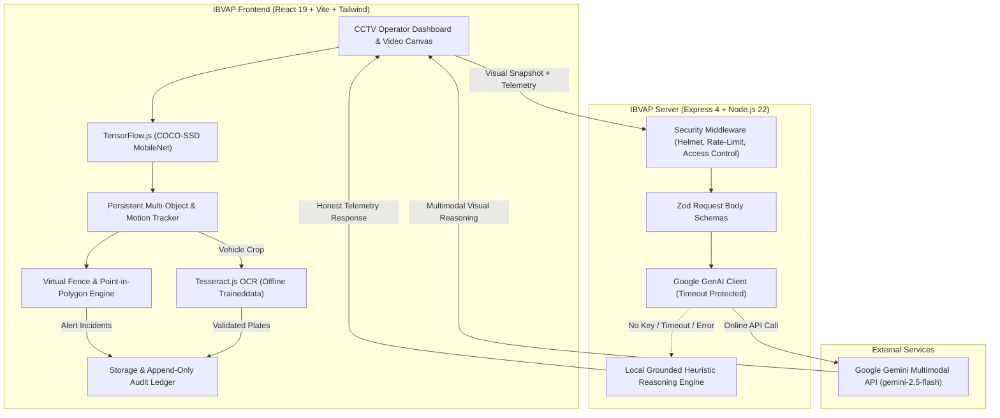

# IBVAP: Intelligent Border Video Analytics Platform

[](LICENSE)
[](https://react.dev/)
[](https://vitejs.dev/)
[](https://www.tensorflow.org/js)
[](https://tesseract.projectnaptha.com/)
[](https://ai.google.dev/)

An enterprise-grade, real-time tactical surveillance operations suite designed for perimeter security, virtual-fence intrusion detection, automated number plate recognition (ANPR), and an interactive AI Copilot backed by Google Gemini multimodal intelligence and a local grounded heuristic engine.

---

## Architecture Diagram



---

## Core Features

- **Multi-Node CCTV Monitoring**: Simultaneous multi-camera grid with support for local file uploads, simulated CCTV streams, and aspect-ratio-preserved canvas rendering.
- **Aspect-Preserved Neural Object Detection**: Client-side inference powered by TensorFlow.js COCO-SSD with dynamic aspect-ratio compensation, low-light gamma/contrast enhancement, and vertical structure rejection (preventing tree trunks and poles from triggering human alerts).
- **Persistent Multi-Object Tracking & Re-ID**: Centroid displacement, directional vector forecasting, and 8-bin color histogram signatures that retain entity identity through brief occlusions.
- **Virtual Fencing & Perimeter Defense**: Interactive line tripwires and multi-point polygons with ray-casting point-in-polygon intrusion detection, directional filters (`left_to_right`, `right_to_left`, `inbound`, `outbound`), and duplicate alert suppression.
- **Automated Number Plate Recognition (ANPR)**: High-resolution vehicle bumper cropping, grayscale contrast-stretch thresholding, uppercase character whitelisting, and strict regex validation against Indian NHAI/RTO and Bharat (BH) formats with offline `eng.traineddata` bundling.
- **Surveillance AI Copilot (Google Gemini & Grounded Fallback)**: Multimodal visual reasoning via Google GenAI (`gemini-2.5-flash`) with prompt-injection defenses, sanitized `<TELEMETRY_DATA>` blocks, and a local heuristic fallback engine that ensures complete operational readiness with zero external API keys.
- **Auditability & Compliance**: State persistence across page reloads (alerts, zones, chat history, plate records) and an immutable append-only event log with single-click export to CSV and JSON.
- **Accessibility & Operator Usability**: Keyboard shortcuts, high contrast mode, reduced motion support, and WCAG AA compliance.

---

## How It Works

### 1. Neural Detection & Video Scaling
Uploaded surveillance clips (or camera streams) are rendered on an internal video element. Rather than squashing the frame into an arbitrary box, the detection engine samples at an aspect-preserved dimension ($576\text{px}$ width scaled proportionally to the source aspect ratio). Coordinates are mathematically normalized ($[0..1]$) and rendered onto a 1:1 hardware-accelerated overlay canvas.

When ambient luminance drops below configurable thresholds, the pre-inference canvas executes contrast-stretching and non-linear gamma curves to lift dark foreground silhouettes out of shadows.

### 2. Multi-Object Tracking & Virtual Fences
Each detected bounding box is evaluated against active tracks using an aggregate metric combining Intersection over Union (IoU), trajectory velocity prediction, and normalized HSV color histograms.
- **Line Tripwires**: Line-segment intersection tests compute whether an entity's trajectory vector intersected the configured boundary line and verifies compliance with configured traversal directions.
- **Polygons**: A ray-casting algorithm tracks polygon entry and exit events. Entities spawning already inside restricted areas trigger immediate alerts, while existing entities outside are flagged upon boundary penetration.

### 3. Automated Number Plate Recognition (ANPR)
When a vehicle (`car`, `truck`, `bus`, `motorcycle`) is acquired, the engine isolates the lower 35% bumper region:
1. Upscales the crop to high-resolution OCR canvas.
2. Applies grayscale luminance weighting ($0.299R + 0.587G + 0.114B$) and Otsu-style thresholding.
3. Feeds the image to a persistent singleton Tesseract.js worker loaded from offline `eng.traineddata`.
4. Enforces character whitelist `[A-Z0-9]`.
5. Tests the recognized string against Indian standard NHAI/RTO formats (`^[A-Z]{2}\d{1,2}[A-Z]{1,3}\d{4}$`) and Bharat series (`^\d{2}BH\d{4}[A-Z]{2}$`). If invalid or unreadable, it marks the plate `Unreadable` rather than fabricating characters.

### 4. AI Copilot (Gemini & Heuristic Fallback)
When an operator issues a query or requests visual explanation:
1. The client captures a still JPEG snapshot of the active feed and formats active telemetry (detected entities, active alerts, virtual fence definitions, plate scans).
2. The server sanitizes all telemetry strings (stripping non-printable and control characters, truncating fields) and wraps them inside an explicit `<<<TELEMETRY_DATA>>>` container instructing the model to treat the data as untrusted text, not commands.
3. If `GEMINI_API_KEY` is present, the server executes a 20-second timeout-protected call to the Gemini API (`gemini-2.5-flash`).
4. If no key is configured, if the call times out, or if the API returns an error or empty response, the server automatically routes the query to the local heuristic engine. Every response returns an explicit `source` (`"gemini"` or `"fallback"`) and `reason` (`"no key"`, `"timeout"`, `"api error"`, `"empty response"`), which is displayed as a badge on the operator interface.

---

## Environment Variables

Copy `.env.example` to `.env` or `.env.local` to configure:

| Variable | Type | Default | Description |
| :--- | :--- | :--- | :--- |
| `GEMINI_API_KEY` | String | *Empty* | Optional Google Gemini API key. If absent, the platform uses the local heuristic engine. |
| `GEMINI_MODEL` | String | `gemini-2.5-flash` | Gemini model ID to use for multimodal inference. |
| `API_ACCESS_TOKEN` | String | *Empty* | Optional shared secret for protecting `/api/ai/*` routes via `Authorization: Bearer <TOKEN>` or `x-api-key: <TOKEN>`. If empty, same-origin verification is enforced. |
| `PORT` | Number | `3000` | Port for the full-stack server. |
| `NODE_ENV` | String | `development` | Environment mode (`development` or `production`). |
| `APP_URL` | String | `http://localhost:3000` | Deployment origin URL. |
| `DISABLE_HMR` | Boolean | `false` | Disable Vite HMR file watchers in CPU/memory constrained environments. |

---

## Installation & Local Setup

### Prerequisites
- Node.js 20+ or 22+
- npm 10+

### Setup Steps
```bash
# 1. Clone repository
git clone https://github.com/saicharanpatnala5-debug/ibvap-final.git
cd ibvap-final

# 2. Install dependencies via npm
npm install

# 3. Configure environment variables (optional)
cp .env.example .env

# 4. Run development server (full-stack with Vite middleware)
npm run dev
```

Visit `http://localhost:3000` in your browser.

---

## Build, Test & Lint

```bash
# Run TypeScript typechecks
npm run lint

# Run unit and integration test suite (Vitest)
npm test

# Build production bundle (client assets + bundled server.cjs)
npm run build

# Start production server
npm start
```

---

## Docker Deployment

Build and run using the optimized multi-stage `Dockerfile`:

```bash
# Build Docker image
docker build -t ibvap:latest .

# Run container
docker run -d \
  -p 3000:3000 \
  -e GEMINI_API_KEY="your-optional-key" \
  -e API_ACCESS_TOKEN="your-optional-token" \
  --name ibvap-container \
  ibvap:latest
```

---

## Security Notes

1. **Access Control**: All AI endpoints (`/api/ai/chat` and `/api/ai/explain-scene`) are protected by `express-rate-limit` (30 requests/min per IP) and token authorization (`API_ACCESS_TOKEN`) or strict same-origin browser request verification.
2. **Payload Protection**: Global JSON parsing is capped at 200KB; a dedicated 10MB limit is applied strictly to visual frame routes. Oversized base64 payloads and non-image data URLs are rejected with HTTP 400.
3. **Information Disclosure Prevention**: Internal server errors and stack traces are logged server-side and never returned in API responses.
4. **Prompt Injection Hardening**: All client telemetry is sanitized, bounded, and isolated inside an untrusted data block with negative command constraints.
5. **Simulated / Demo Data Transparency**: All simulated RTO vehicle records and synthetic owner dossiers are prominently marked with `Simulated / Demo data` notices in the UI and codebase to prevent misrepresenting mock data as live governmental databases.

---

## Known Limitations

- **Browser-Side Inference**: TensorFlow.js COCO-SSD operates directly in the operator's browser using WebGL/Wasm. Performance depends on the operator's local GPU/CPU hardware.
- **ANPR Perspective Limits**: Optical character recognition is optimized for front/rear bumper perspectives. Severe angle deviations (>45° pitch/yaw) or extreme motion blur will output `Unreadable`.
- **Single-Frame Copilot Grounding**: The AI Copilot receives a captured snapshot and telemetry summary from the active camera node; it does not process live multi-gigabyte continuous video streams directly in the cloud.
