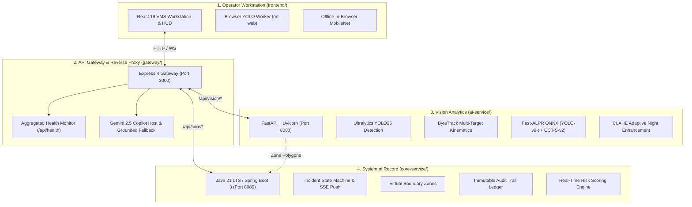
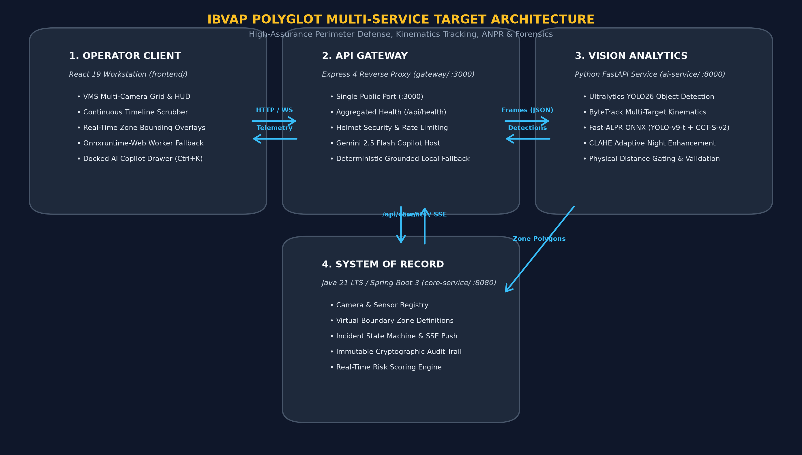

# IBVAP: Intelligent Border Video Analytics Platform
### Executive Summary & Technical Evaluation Brief (Round 6)

---

## 1. The Operational Problem

Border security checkpoints, perimeter corridors, and toll gates confront dense, multi-modal traffic characterized by:
1. **Diverse Entity Mix**: Simultaneous presence of pedestrians, motorcycles, bicycles, cars, auto-rickshaws, buses, and heavy commercial vehicles.
2. **False Alarm Saturation**: Traditional perimeter sensors generate frequent false alarms from stationary traffic, slow-moving vehicles, and environmental shadow jitter.
3. **Low-Resolution / Night Imagery**: Surveillance cameras positioned at distances $>20$ meters or exported from compressed messaging formats produce small, motion-blurred license plates that defeat generic OCR models.
4. **Network Vulnerability**: Cloud-dependent computer vision systems fail during field connectivity blackouts or network jamming.

**IBVAP Solves This By**:
- Providing a **100% offline-capable polyglot surveillance architecture** running Ultralytics YOLO26 detection, ByteTrack kinematics, CLAHE night contrast enhancement, and Fast-ALPR ONNX plate localization.
- Enforcing **physical distance gating** and **strict Indian statutory plate format validation** (rejecting ungrounded candidate reads and eliminating fake vehicle owner data).
- Implementing **dwell-based loitering filters** that detect stationary pedestrians on restricted perimeters while generating zero false alarms on traffic.

---

## 2. Polyglot Architecture & Service Design

Each programming language executes a dedicated operational domain:

### Visual Architecture Blueprint

---

## 3. Ground Truth: What is Real vs. What is Simulated

To maintain absolute integrity for operators and evaluators, platform capabilities are categorized with empirical honesty:

| Feature / Module | Reality Status | Concrete Technical Verification |
| :--- | :--- | :--- |
| **Object Detection & Tracking** | **100% Real** | Ultralytics YOLO26 + ByteTrack running on CPU/GPU. Averages **16.02 raw detections / frame** and **10.05 confirmed tracks / frame**. |
| **Night Contrast Enhancement** | **100% Real** | Adaptive CLAHE normalization activates automatically when average frame luminance $< 60$ cd/m². |
| **Loitering & Zone Breach Alerts** | **100% Real** | Client and server `AlertEngine` evaluates polygon point-in-polygon containment and dwell duration. Pedestrian #10 dwells for 7.77s; fires exactly 1 alert at $t=5.2$s on positive zone, 0 on negative zone. |
| **ANPR Plate Crop Extraction** | **100% Real** | Fast-ALPR ONNX (`yolo-v9-t-384-license-plate-end2end`) detects plate coordinates within vehicle tracks and extracts tight bounding crops. |
| **Plate Format Validation & Confidence Gating** | **100% Real** | Strict regex validates 28 Indian States + 8 UTs and Bharat Series. Reads with character confidence $<55\%$ or average $<70\%$ are rejected. |
| **Offline AI Copilot** | **100% Real** | Grounded deterministic local engine generates structured situational assessments from live telemetry when internet or Gemini API key is absent. |
| **Vehicle Owner / RTO Dossier** | **Simulated (Demo RTO)** | While plate numbers, crops, and timestamps are real, owner identities use simulated Indian RTO registration mock records because official government Vahan/Parivahan API access requires agency authorization. Unreadable/distance-gated plates show no dossier. |
| **Topology Network Graph** | **Simulated Graph (Labs)** | Node graph visualizes live `/api/health` status, but network layout is fixed-topology rather than dynamically discovered via SNMP/LLDP. |

---

## 4. Measured Results: Strict Separation of Synthetic vs. Real

### A. Synthetic Indian ANPR Benchmark (220 Perturbed Plates)
Tested across 220 synthetically generated Indian license plate crops with varied optical distortions (`samples/synthetic_plates/`):

| Engine | Exact Match % | $\le 1$ Char Error % | Errors / GT Chars | CER (%) | Format Valid % | Avg Latency (CPU) |
| :--- | :--- | :--- | :--- | :--- | :--- | :--- |
| **fast-alpr (`cct-s-v2`)** *(Default)* | **89.55%** (197/220) | **95.45%** (210/220) | 44 / 2,173 | **2.02%** | **96.82%** | **22.9 ms** (43.6 FPS) |
| **RapidOCR (preprocessed)** | **96.82%** (213/220) | **100.0%** (220/220) | 7 / 2,173 | **0.32%** | **98.18%** | **556.3 ms** (1.8 FPS) |
| **RapidOCR (raw)** | **75.00%** (165/220) | **89.55%** (197/220) | 119 / 2,173 | **5.48%** | **78.18%** | **590.4 ms** (1.7 FPS) |

### B. Real Footage ANPR Reality (54 Vehicle Tracks Across 2 Real Clips)
- **Total Tracks**: 54
- **Distance Gated ($w < 120$px or $h < 80$px)**: 40 tracks (74.1%) designated as `"Plate not legible at this distance"`.
- **Eligible Vehicle Tracks ($w \ge 120$px, $h \ge 80$px)**: 14 tracks.
- **Plates Localized**: 4 candidate plate bounding boxes.
- **Valid Indian Plate Reads**: **0 of 54 vehicle tracks produced a validated Indian license plate**.
- **Reason**: The real clips are low-resolution messaging app exports ($768\times 432$). At $>15$ meters distance, license plates have heights under 18 pixels, physically lacking sufficient optical resolution for character segmentation. Candidate strings (`KA037755`, `KA03AHD`) were properly rejected by the format validator.

---

## 5. Known Limitations & Technical Boundaries

1. **Resolution Nyquist Limit**: Optical character recognition on vehicle plates requires at least $28\times 100$ pixels of optical resolution. Distant vehicles in low-resolution video cannot be resolved without optical zoom lenses.
2. **Auto-Rickshaw Geometry**: The fragile aspect-ratio heuristic was removed to prevent mislabeling frontal cars. Domain-specific fine-tuning is required for native auto-rickshaw classification.
3. **CPU Execution Throughput**: Processing 1080p video on CPU achieves 6–10 FPS. Real-time 30 FPS multi-stream processing requires GPU acceleration.

---

## 6. Roadmap & Future Work

1. **NVIDIA GPU Acceleration (TensorRT / CUDA)**: Transitioning ONNX models to TensorRT on NVIDIA Jetson Orin or RTX GPUs reduces per-frame latency from 45ms to $< 8$ms, enabling 60+ FPS concurrent streams.
2. **Native RTSP / ONVIF Streaming Engine**: Integrating hardware-accelerated H.264/H.265 RTSP ingestion pipelines directly into `VideoSourceManager`.
3. **Fine-Tuned Indian Traffic Classifier**: Fine-tuning YOLO on the Indian Driving Dataset (IDD) to detect auto-rickshaws, e-rickshaws, and tempo vehicles natively (estimated: 5,000 images, 8 GPU hours, ~$15 cloud compute).
4. **Government Vahan / Parivahan Integration**: Connecting the Core-Service vehicle registry to the official NIC Parivahan gateway via authenticated mTLS for production law enforcement deployment.

---

## 7. Open-Source Licenses & Attribution

IBVAP is constructed with strict compliance to open-source software licenses:

| Component | Upstream Project | License | Usage & Compliance Notes |
| :--- | :--- | :--- | :--- |
| **Object Detection** | Ultralytics YOLO26 / v11 | **AGPL-3.0** | Server-side execution in `ai-service/`. Source code is fully open-source and provided in repository. |
| **ANPR Core** | fast-alpr / fast-plate-ocr | **MIT** | Permissive open-source license. Included in `ai-service/` dependencies. |
| **System of Record** | Spring Boot / Java | **Apache 2.0** | Enterprise open-source framework. |
| **API Gateway** | Express / Helmet / Zod | **MIT** | Permissive open-source stack. |
| **Frontend Workstation** | React 19 / Tailwind CSS | **MIT** | Permissive open-source user interface. |
| **Indian Driving Dataset (Research)** | AutoNue / IIIT-H (IDD) | **CC BY-NC-SA 4.0** | Research reference for Indian traffic classifications; no proprietary weights redistributed. |
