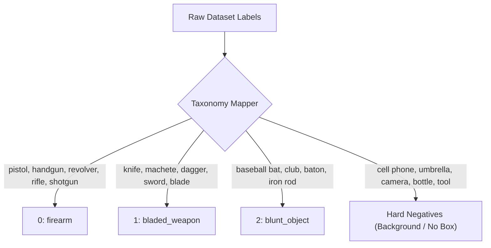

# Weapon Detection (Beta) - Dataset Survey & Taxonomy Specification

## 1. Executive Summary

This survey establishes the training and evaluation foundation for the experimental **Weapon Detection (Beta)** capability in IBVAP v8.0.0. The subsystem operates behind an explicit feature flag (`WEAPON_DETECTION=false` by default) as a human-in-the-loop decision-support tool.

### Ethical & Regulatory Governance Constraints
- **Strictly Object-Centric**: Detects physical, tangible objects only (`firearm`, `bladed_weapon`, `blunt_object`).
- **Zero Role-Based Person Labeling**: Any dataset labels categorizing individuals (e.g., "gunman", "attacker", "robber", "terrorist", "suspect") are categorically excluded and stripped.
- **Zero Demographic Bias**: No classes or features evaluate facial features, skin tone, gender, age, religious attire, head coverings, or clothing as threat indicators.
- **Human-in-the-Loop Mandate**: Detections are designated as `"possible_weapon"`, never trigger automatic lethal or autonomous escalations, and require active operator verification.

---

## 2. Surveyed Open Datasets

| Dataset | Publisher / Source | License | Sensor Context | Object Annotations | Evaluation for IBVAP |
| :--- | :--- | :--- | :--- | :--- | :--- |
| **Granada CCTV Weapons Dataset** | University of Granada (SCI2S Lab) | Open Research / CC BY-NC 4.0 | Real low-resolution CCTV (indoor/outdoor, realistic height & angle) | Handguns, small knives, long guns | **High Value**: Closest match to actual tactical CCTV angles, noise, and optical blur. Useful for evaluation. |
| **Roboflow Universe Weapon Datasets** | Curated Open Community | **CC BY 4.0** | Varied CCTV, handheld video, simulated surveillance | `pistol`, `knife`, `rifle`, `bat` (bounding boxes) | **Core Training**: Clean, permissively licensed annotations with normalized bounding boxes compatible with YOLO format. |
| **Simuletic Synthetic CCTV Weapons** | Simuletic AI Lab | **CC BY 4.0** | Photorealistic synthetic multi-angle surveillance feeds | Firearms, knives, varied occlusion and illumination | **Augmentation**: High precision bounding boxes without privacy, consent, or ethical concerns of capturing real individuals. |
| **MS COCO & Open Images v7** | Common Objects in Context / Google | **CC BY 4.0** | Natural indoor/outdoor scenes | Everyday handheld objects (cell phone, umbrella, bottle, camera, tools) | **Essential Hard Negatives**: Prevents false positive alarms on phones, umbrellas, tools, and bottles in benign traffic. |

---

## 3. Unified Class Taxonomy

To minimize confusion in CCTV resolution and maximize generalization across different makes and models, the detector collapses fine-grained labels into a concise 3-class object taxonomy:

### Class Definitions
1. **`firearm`** (Class ID `0`): Handheld lethal projectile devices including pistols, revolvers, carbines, shotguns, and assault rifles.
2. **`bladed_weapon`** (Class ID `1`): Edged or pointed instruments capable of stabbing or slicing, including knives, daggers, cleavers, and machetes.
3. **`blunt_object`** (Class ID `2`): Heavy elongated impact instruments including baseball bats, tactical batons, and iron rods held in aggressive posture.
4. **Hard Negatives (Class `-1` / Background)**: Normal everyday items frequently misidentified by naive models:
   - Smartphones and electronic tablets
   - Umbrellas and parasols
   - Power tools (drills, impact drivers) and hand tools (wrenches, hammers)
   - Water bottles, thermoses, and beverage cups
   - Handbags, backpacks, and luggage straps

---

## 4. Minimum Resolution & Detectability Boundaries

In typical 1080p and 720p surveillance streams:
- A compact handgun ($18 \times 12$ cm) at 15 meters occupies fewer than $12 \times 8$ pixels, falling below the optical Nyquist sampling limit for reliable feature discrimination.
- **Operational Requirement**: The detector must operate on both the full frame (for long guns and large bladed weapons) and on **upscaled person-region crops** ($w \ge 120$ px, $h \ge 240$ px) to provide sufficient spatial resolution ($> 28 \times 28$ px) for small handgun and knife localization.
- Candidate detections with object bounding box area $< 25 \times 25$ pixels are gated as physical resolution limited to suppress optical noise artifacts.
